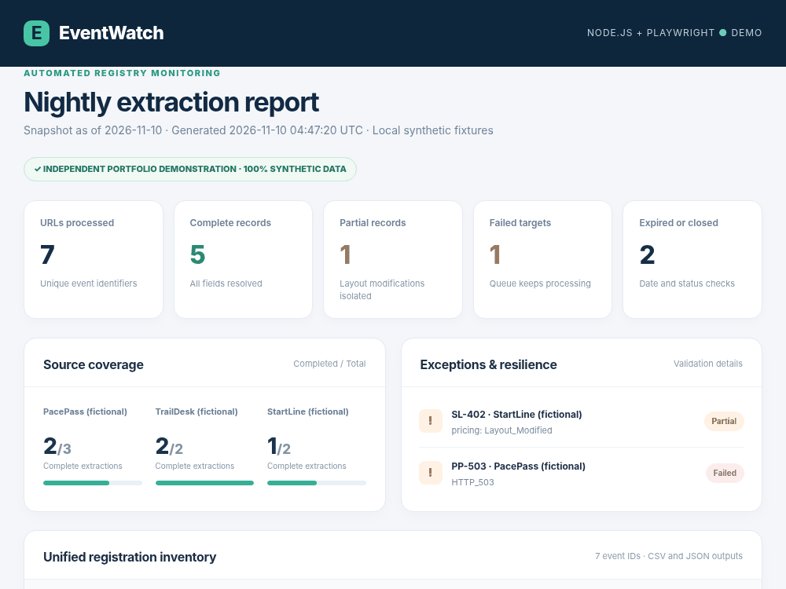

# EventWatch — Node.js + Playwright Nightly Registration Monitor

**Independent Upwork portfolio demo | 100% synthetic data and fictional registration websites**

A backend-first scraping pipeline built with Node.js and Playwright. Three small, locally hosted event registration engines render their registration details **after JavaScript executes**. The crawler opens each page, interacts with dynamic sections, extracts inventory/capacity and price-change dates, checks event dates for expiry, and produces consolidated CSV/JSON reports. Individual selector failures and HTTP 503 responses (after bounded retries) are reported without stopping the entire queue.



## Demo in one command

Requirements: **Node.js 20+**, Playwright and its Chromium browser.

```bash
npm install
npx playwright install chromium
npm run demo
```

Then open **`output/report.html`** in any browser. You can inspect example results without running Node in `samples/` (loopback ports normalized for documentation). The demo starts a local fixture HTTP server, feeds its synthetic HTML to Playwright for JavaScript execution (using `page.setContent` to work in restricted browser environments), processes 7 fixture URLs, stops the server and leaves the report/CSV/JSON on disk. Production-mode authorized scraping uses Playwright `page.goto` rather than fixture injection. **It never contacts RunSignup, Active.com, Race Roster, or any real third-party platform.**

To recreate authentic screenshots:

```bash
npm run capture
```

To run tests:

```bash
npm test
```

The system relies only on Playwright and Node.js built-ins; it does not require API keys, paid residential proxies, external services or credentials for the local demo.

## Verified demo behavior

- **Dynamic JavaScript:** all three fictional platforms render after page load; one requires an interactive click to reveal registration details.
- **Capacity:** parses `85% Full`, `50 Slots Left`, and a `Tier Closed` label.
- **Pricing:** parses clear upcoming dates; records `Layout_Modified` if the expected element is absent.
- **Historical & closed:** flags events with dates in the past or pages that explicitly indicate registration closure.
- **Fault isolation and retries:** `SL-402` lacks its price element (partial record); `PP-503` simulates HTTP 503 (failed record after up to 3 attempts with short backoff); all remaining records are processed.
- **Structured outputs:** CSV and JSON are replaced atomically per run and keyed by unique stable event IDs; no duplicate records across runs.
- **Observability:** NDJSON logs capture per-URL results and batch summaries.
- **Concurrency:** configurable bounded parallelism (1–4 pages); single browser context; process lock avoids concurrent batch output collisions.
- **Private cloud delivery:** optional Dropbox API v2 uploader with overwrite semantics, OAuth token from environment variables, and mock-tested request structure. **A real Dropbox upload was not performed.** Cloud failures produce a nonzero process exit while retaining local snapshots so a scheduler can alert.
- **Optional authorized proxy:** a single environment-provided network proxy may be configured for approved endpoints; **no proxy rotation or anti-bot evasion is implemented.**

## Project structure

```text
src/
  mock-server.js       3 fictional JavaScript-rendered registration platforms
  adapters.js          per-source selectors
  scraper.js           Playwright browser, queue processing and host allowlist
  normalize.js         capacity, pricing dates and status rules
  batch.js             orchestration, logs and optional cloud export
  cloud.js             Dropbox files/upload adapter (optional)
  export.js            CSV, atomic overwrite and process lock
  report.js            generated standalone HTML report
  demo.js              one-command demonstration
  cli.js               external authorized-target runner
scripts/capture.js     screenshots from actual locally generated output
tests/                 Node built-in test runner, including browser integration
data/targets.example.json   example local-target manifest
samples/                generated sample CSV and JSON with canonicalized loopback ports
examples/cron-2am-est.txt  documented scheduler configuration
docs/                  authentic screenshots for the portfolio
```

## Running scheduled authorized targets

1. **Obtain permission** to access the event data and verify platform terms and approved access/API options.
2. Place your approved URLs in a private JSON manifest, with `event_id`, `platform` (an adapter you implement) and `url`. Never commit confidential target lists.
3. Set `ALLOWED_TARGET_HOSTS` with the explicitly authorized domains. By default only `127.0.0.1` and `localhost` are permitted.
4. Run `node src/cli.js /path/to/targets.authorized.json` using an external scheduler or nightly cron. Use the `--dropbox` flag only after securely configuring the environment variables and testing the upload flow in your own account.

**Scheduling:** `2:00 AM EST` every day means `07:00 UTC` year-round. This is *not* the same as `2:00 AM America/New_York` throughout daylight saving time. An annotated example is in `examples/cron-2am-est.txt`; choose the client's desired semantics and an appropriate scheduler. The nightly batch does not run continuously and does not contain an always-on scheduler.

## Security, production and NDA boundaries

This portfolio demo does **not** bypass Akamai Bot Manager, Cloudflare, CAPTCHAs or other third-party anti-bot systems. It does not implement stealth fingerprint randomization, rotating residential/mobile proxies, or randomized cursor movement intended to evade detection. Those aspects cannot be credibly demonstrated or guaranteed without documented authorization and a scoped feasibility study. **Do not represent this as having passed real anti-fingerprint tests.**

For production, complete approved-source integration, secure secret management and OAuth refresh tokens, logging redaction, alerting, a durable scheduler, appropriate network/IP policies, retry/backoff tuning, consent checks, and staging evidence against authorized URLs. The Dropbox upload adapter uses a supplied active access token; a background integration would need a refresh-token lifecycle.

The mock event sites and all business data were written independently. No private employer systems, customer information or prospect-provided NDA material is included.
